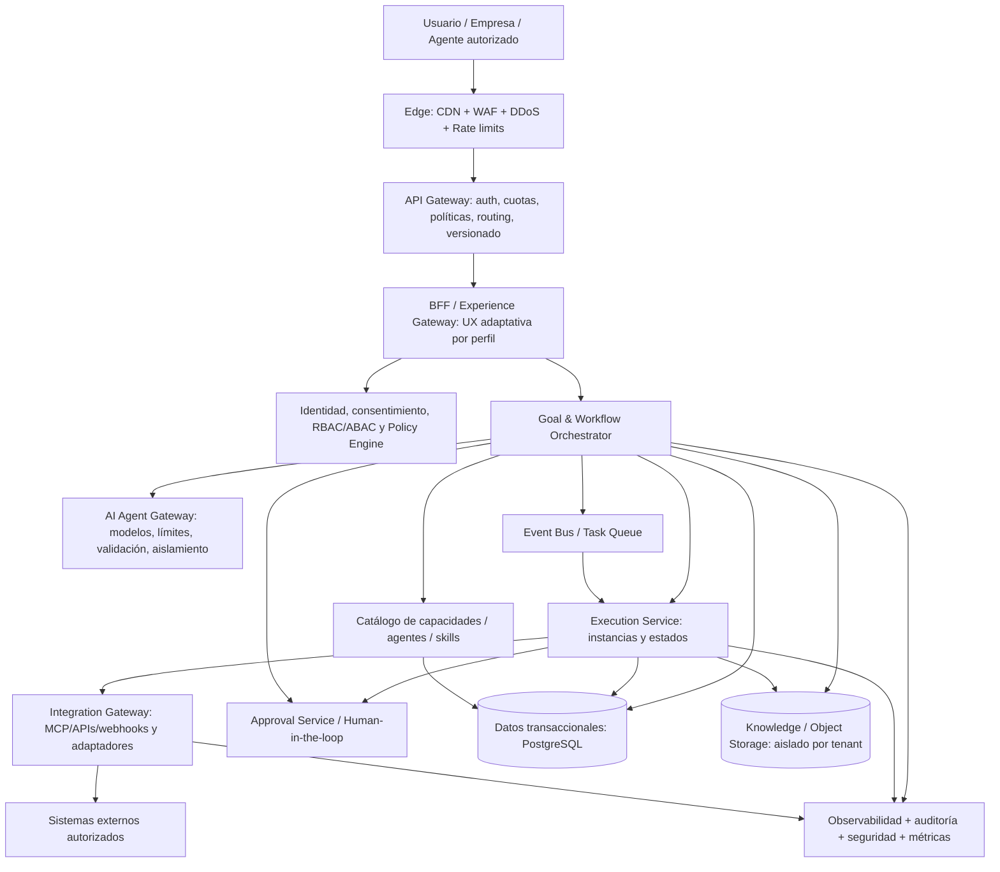

# SUPER SYSTEM — Plan maestro y arquitectura v0.1
**Fecha:** 2026-11-13 · **Estado:** propuesta inicial para revisión · **Alcance:** arquitectura objetivo + MVP comprobable  
**Convocatoria pública (ES/EN/中文):** https://github.com/fedeflores25/PruebaGit/issues/1

> Este documento expone una visión tecnológica y objetivos de diseño; **no describe una implementación ya existente**. No incluye credenciales, configuraciones privadas ni información personal.

## 1. Visión estratégica
Desarrollar un **software distribuido de nueva generación**, capaz de integrar y sustituir progresivamente sistemas y herramientas digitales fragmentados, con una experiencia adaptativa centrada en cada usuario. Coordinará personas, agentes de IA, procesos, conocimiento y aplicaciones.

**ES:** Un sistema para reemplazar progresivamente la fragmentación, no una promesa de reemplazo universal inmediato.  
**EN:** A secure, distributed, user-adaptive system designed to progressively replace fragmented digital tools and workflows.  
**中文:** 构建一个高度安全的分布式自适应软件系统，逐步替代碎片化的数字工具、平台与工作流程。

**Principio:** primero probar interoperabilidad y valor medible; luego sustituir funciones concretas solo cuando exista evidencia de mayor calidad, eficiencia y seguridad.

## 2. Requisitos de producto no negociables
- **Diseño de otro nivel:** lenguaje visual coherente, experiencia conversacional y visual, jerarquía clara, interfaces adaptativas, responsive, accesibilidad WCAG 2.2 AA como objetivo, internacionalización ES/EN/中文, explicabilidad y reversibilidad de acciones.
- **Máxima seguridad alcanzable y verificable:** defensa en profundidad, Zero Trust, identidad fuerte, mínima exposición, controles por servicio, vigilancia y auditoría continuas. No existe «seguridad absoluta».
- **Sistema distribuido:** servicios independientes donde la separación sea valiosa; resiliencia ante fallos parciales, asincronía cuando corresponda, observabilidad distribuida.
- **SOA + microservicios + gateways:** capacidades expuestas mediante contratos versionados; despliegue separado cuando exista autonomía real de dominio, escalabilidad o riesgo. Evitar «microservicios por moda» y monolitos distribuidos.
- **Adaptación por usuario y organización:** preferencias explícitas, accesibilidad, contexto de tarea, idioma, roles, permisos, experiencia y automatizaciones consentidas. Nunca inferir o reutilizar información privada entre usuarios.
- **Portabilidad:** estándares abiertos, contratos exportables, interoperabilidad multi-proveedor y salida sin cautividad técnica.

## 3. Arquitectura lógica objetivo



**Tres planos separados:** *Experience Plane* (interacción personalizada), *Control Plane* (identidad, planificación, políticas, decisiones) y *Execution Plane* (microservicios, agentes, herramientas y trabajos). El bus de eventos desacopla procesos; el gateway no es un reemplazo de la autorización interna.

### Servicios / dominios candidatos
1. **Identity & Organization:** usuarios, organizaciones, autenticación, sesiones, roles, consentimiento.
2. **User Experience & Personalization:** diseño, preferencias, accesibilidad, idioma, contexto de interacción; no decide permisos.
3. **Capability Registry:** definiciones versionadas de agentes, skills, herramientas y conectores.
4. **Goal & Workflow:** objetivos, tareas, dependencias, planes, reglas de negocio y orquestación.
5. **Execution:** activaciones, estados, reintentos, cancelaciones, resultados y errores.
6. **AI Gateway:** ruteo a modelos, presupuestos, políticas, aislamiento de contexto y evaluación de salidas.
7. **Integration Gateway:** credenciales de alcance mínimo, conectores, webhooks firmados, límites y revocación.
8. **Approvals & Policies:** autorizaciones humanas y automáticas mediante reglas verificables, segregación de funciones.
9. **Knowledge & Artifacts:** documentos, versiones, permisos, exportación y borrado.
10. **Audit & Observability:** eventos, trazas distribuidas, alertas, métricas de costo, seguridad y calidad.

**Disciplina arquitectónica:** estas son *fronteras lógicas*, **no diez despliegues obligatorios desde el día uno**. Para el MVP, agrupar servicios pequeños cuando comparten transacción y ciclo de cambio. Extraer microservicios solo ante evidencia de necesidad y contratos estables.

## 4. Seguridad desde el diseño (Security by Design)
**Baseline recomendado:** NIST SP 800-207 (Zero Trust); OWASP ASVS 5.0.0; modelado de amenazas y revisión de riesgos por release.

### Controles mínimos del MVP
- **Identidad:** OIDC; MFA resistente a phishing / passkeys donde esté soportado; autenticación de servicios con identidades de workload y mTLS cuando sea viable.
- **Autorización:** autorización del lado servidor en **cada servicio**; RBAC + ABAC para usuario, tenant, recurso y operación; principio de menor privilegio y denegación por defecto.
- **Aislamiento:** separación entre tenants en datos, caché, colas, archivos, logs y memoria/contexto de modelos; pruebas automatizadas contra accesos cruzados.
- **Protección de datos:** TLS en tránsito, cifrado en reposo con gestión centralizada de claves, secretos fuera del código, minimización de datos, expiración/retención y borrado verificable.
- **Acciones de IA:** cada herramienta tiene lista permitida, alcance, cuota, límites económicos y nivel de autorización; acciones sensibles requieren aprobación explícita y confirmación del resultado.
- **Resistencia a inyección de prompts:** tratar contenido externo, Issues, documentos y respuestas de modelos como **datos no confiables**; no elevarlos a instrucciones del sistema, nunca ejecutar comandos derivados sin validación/política.
- **Red y aplicaciones:** WAF y límites perimetrales, rate limiting por cliente, protección SSRF, validación estricta, aislamiento del ejecutor y egress control.
- **Supply chain:** dependencias fijadas, SBOM, escaneo SAST/SCA/DAST, análisis de secretos, firma de artefactos y controles CI/CD; ambientes separados.
- **Operación:** eventos de auditoría con integridad, alertas SIEM, backups restaurables, plan de respuesta a incidentes, revocación y apagado de emergencia, pruebas periódicas.
- **Gobierno:** privacidad desde el diseño, controles de residencia de datos y cumplimiento aplicable según jurisdicción. No almacenar datos personales en un repositorio público.

### Objetivos de prueba de seguridad
- 0 accesos entre tenants en pruebas funcionales, de integración y negativas.
- 100% de acciones externas con identidad, permiso evaluado, trazabilidad y resultado.
- 100% de caminos críticos incluidos en threat model y criterios ASVS definidos para el alcance.
- Simulaciones de prompt injection y de pérdida de conectores sin permisos indebidos.
- Restauración de backup demostrada en un entorno aislado.

## 5. Adaptación profunda al usuario (sin invadir privacidad)
Modelo de personalización **explícito, portable y reversible**:
- **Perfil:** preferencias, idioma, accesibilidad, nivel de experiencia, contexto profesional, metas y restricciones declaradas por el usuario.
- **Espacios:** personales y organizacionales separados; pertenencia y permisos definidos.
- **UX adaptativa:** misma capacidad con vista simple/experta, distintos flujos, formularios o chat según uso, sin ocultar información crítica.
- **Orquestación adaptativa:** tareas y herramientas según objetivo, capacidades disponibles, nivel de autonomía autorizado, sensibilidad y presupuesto.
- **Aprendizaje:** mejoras basadas en feedback **solo bajo consentimiento**, explicables y configurables; opción de apagar perfilado o borrar memoria personal.
- **Antisesgos:** accesibilidad, transparencia, control del usuario; personalización **nunca** altera las políticas de seguridad ni autoriza nuevas acciones por sí sola.

## 6. Modelo de datos inicial y protocolo
Reutilizar conceptualización de Atnirdes: **definición de capacidad de IA ≠ ejecución concreta**; una capacidad versionada puede originar múltiples ejecuciones con estados e historial independientes.

Entidades: Tenant, User, Profile, Role, Policy, Capability, AgentDefinition, Goal, Task, Execution, ToolGrant, Approval, Message, Artifact, AuditEvent.

```json
{
  "message_id": "uuid",
  "schema_version": "1.0",
  "correlation_id": "uuid",
  "tenant_id": "tenant-opaque-id",
  "task_id": "task-opaque-id",
  "sender": "authenticated-principal",
  "intent": "propose|execute|result|request_approval",
  "created_at": "2026-11-13T00:00:00Z",
  "payload_ref": "authorized-artifact-reference",
  "policy_context": "bounded-reference",
  "idempotency_key": "uuid"
}
```

Requisitos distribuidos: **at-least-once + idempotencia**, timeouts, colas de trabajo y dead-letter, reintentos limitados, transacciones locales con transactional outbox cuando proceda, sagas/compensaciones para acciones distribuidas, consistencia eventual donde se tolere y consistencia fuerte para autorizaciones/finanzas/estados críticos. Correlation IDs + trazas. No prometer exactly-once universal.

## 7. MVP / Experimento vertical #1
**Caso de uso:** una persona pide «investigá, contrastá y entregá un informe con fuentes y revisión». Un orquestador reparte tareas a dos agentes diferentes; uno recopila información con acceso autorizado, otro contrasta, un validador evalúa, y el usuario aprueba el resultado antes de publicarlo en el destino autorizado.

**Incluye:** login, perfil, objetivo, dos agentes, una cola, políticas y autorización, gateway de herramientas con 1–2 conectores, trazabilidad, panel de seguimiento y descarga/exportación.  
**Excluye por ahora:** economía autónoma, pagos, internet abierta sin restricciones, auto-modificación de políticas, acceso público a datos internos, microservicios indiscriminados y despliegue multinube/multirregión sin demanda medida.

### Aceptación del experimento
- 10 ejecuciones de prueba reproducibles; ninguna acción sensible sin consentimiento.
- Dos agentes participan mediante contratos definidos y evidencias de intercambio.
- Al menos una falla simulada (timeout o conector inaccesible) con recuperación o falla segura.
- Cada paso muestra actor, permiso, evento, artefacto y resultado verificable.
- Registro de tiempos, costo por tarea, intervención humana, tasa de fallos y evaluación de calidad frente a ejecución manual.
- Diseño probado en móvil y escritorio con controles de accesibilidad.
- Un caso fallido documentado con causa y corrección, no ocultado.

## 8. Fases y puertas de decisión (estimaciones de planificación, no compromisos)
| Etapa | Entregable | Criterio para avanzar |
|---|---|---|
| F0 — Discovery y amenazas (semanas 1–2) | Problema priorizado, actores, riesgos, diagramas C4 nivel 1/2, 5 historias de usuario, ADR iniciales | Un flujo vertical valioso y alcance cerrado |
| F1 — Fundaciones (semanas 3–5) | Identidad, perfiles, autorización, catálogo, ejecución, event log, gateways básicos | Casos unitarios/integración de permisos y estados aprobados |
| F2 — Coordinación (semanas 6–9) | Dos agentes, contratos, colas, validación, aprobaciones, UI adaptativa | 10 tareas reproducibles + falla controlada |
| F3 — Piloto (semanas 10–12) | Evaluación con usuarios voluntarios, seguridad, observabilidad, documentación | Mejora frente a baseline y sin hallazgos críticos abiertos |
| F4 — Escalado condicionado | Separación adicional de servicios, high availability, resiliencia, capacidades nuevas | Datos de uso y necesidad operativa justifican complejidad |

Los plazos se revisarán según equipo, presupuesto, riesgos y dependencias.

## 9. KPIs de validación
**Valor:** tiempo hasta resultado validado, costo completo por tarea, pasos manuales evitados, calidad frente a baseline.  
**Confianza:** porcentaje de acciones con aprobación requerida satisfecha, eventos auditables, incidentes y vulnerabilidades críticas pendientes.  
**Confiabilidad:** tasa de ejecución completa, recuperación de fallos, duración p95 por tipo de tarea, tasa de duplicación/reintentos.  
**Experiencia:** finalización de tarea, accesibilidad, comprensión del estado y facilidad de corrección.  
**Guardrails:** filtraciones de datos entre tenants = 0; acciones no autorizadas = 0; sin hallazgos críticos abiertos para piloto.

No fijar promesas de SLA / RTO / RPO sin haber medido dependencias, costo y arquitectura física.

## 10. Decisiones y asuntos abiertos
1. **ADR-001 (propuesto):** dominios SOA + extracción selectiva de microservicios en lugar de implementar todos desde el MVP.
2. **ADR-002 (propuesto):** PostgreSQL como base transaccional; bus de eventos solo cuando el flujo lo necesite.
3. **ADR-003 (propuesto):** GitHub Issues es punto de convocatoria, **no** un canal de agentes autónomos ni una superficie para secretos.
4. **Pendiente:** plataforma de despliegue; costos operativos; clasificación de datos y residencia; modelos/proveedores; licenciamiento y gobernanza de contribuciones.
5. **Pendiente:** selección del primer sector/producto de referencia, diseño de experiencia visual, estrategia de pruebas y threat model detallado.
6. **Pendiente:** decidir separación legal y técnica entre material de planificación público y repositorios privados de implementación.

## 11. Solicitud de colaboración (ES / EN / 中文)
Se invita a desarrolladores, arquitectos, especialistas en UX, seguridad, sistemas distribuidos, IA y operadores de agentes a revisar especialmente: diseño SOA/microservicios, gateways, zero trust, adaptación por usuario y pruebas falsables.

**EN:** Seeking reviewers and collaborators for secure distributed architecture, service-oriented design, API and agent gateways, adaptive UX and measurable proof of concept.

**中文:** 诚邀分布式系统、微服务、SOA 架构、API 网关、网络安全及自适应用户体验方面的开发者和研究人员共同审查并完善本计划。

Responder con `[PROPOSAL]`, `[QUESTION]`, `[RISK]` o `[HELLO]` en https://github.com/fedeflores25/PruebaGit/issues/1. No conceder credenciales ni acceso a recursos privados.

## 12. Fuentes de referencia para validación
- NIST SP 800-207 — Zero Trust Architecture: https://www.nist.gov/publications/zero-trust-architecture
- OWASP ASVS 5.0.0 — Application Security Verification Standard: https://asvs.owasp.org/
- W3C WCAG 2.2 — Web Content Accessibility Guidelines: https://www.w3.org/TR/WCAG22/

**Trazabilidad:** la propuesta pública v0.1 no implica que estén implementados servicios, integraciones ni controles de seguridad.
